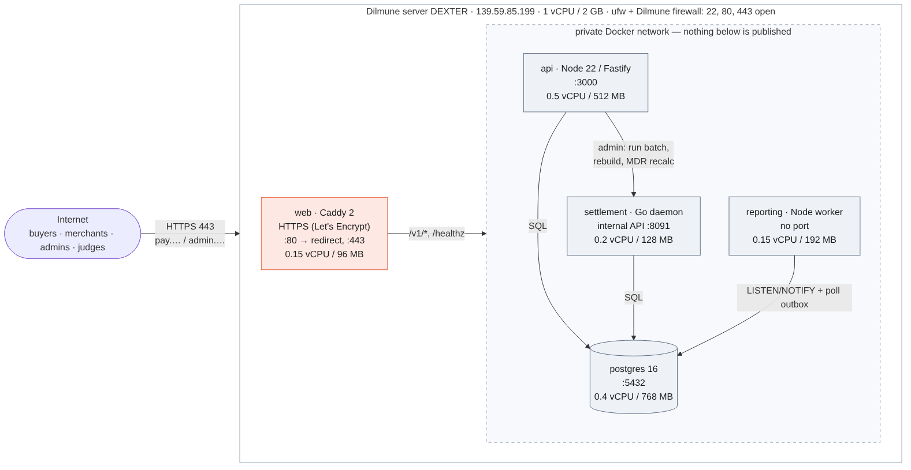

# Deployment and capacity (submission sections 2 and 3)

Written by Ghadah (deployment owner). Everything below was run on the live
Dilmune server on 30 Oct 2026.

## For the cover page: live URLs

| What | URL |
| --- | --- |
| Checkout (hosted payment page) | `https://pay.139-59-85-199.sslip.io/pay/<link token>` |
| Merchant dashboard | https://pay.139-59-85-199.sslip.io |
| Admin console | https://admin.139-59-85-199.sslip.io |
| Public API | `https://pay.139-59-85-199.sslip.io/v1/...` (health: https://pay.139-59-85-199.sslip.io/healthz/db) |

Server: Dilmune Cloud "DEXTER", 139.59.85.199, Ubuntu, 1 vCPU / 2 GB RAM.
`sslip.io` is a public wildcard DNS name that resolves to the IP inside it.
Caddy gets a Let's Encrypt certificate for both names, so everything is HTTPS.

---

## 2. Architecture and deployment

**Facing the internet: only Caddy (`web`), on 80 and 443.** Port 80 only
redirects to HTTPS and answers the certificate challenge. The API (3000),
settlement's internal API (8091) and Postgres (5432) sit on the private Docker
network and are not published on the host. Before this, compose published
Postgres on `0.0.0.0:5432` with the password in the file.

| Service | Role | Port (internal) | CPU / memory cap | Restart | Health check |
| --- | --- | --- | --- | --- | --- |
| web (Caddy) | HTTPS, static dashboard + admin, proxies `/v1/*` | 80, 443 (public) | 0.15 / 96 MB | unless-stopped | — |
| api (Node) | Public + merchant + admin API | 3000 | **0.5 / 512 MB** (V8 heap 320 MB) | unless-stopped | `GET /healthz/db` every 10 s, a live DB query |
| settlement (Go) | Nightly close, payouts, internal admin API | 8091 | 0.2 / 128 MB | unless-stopped | — |
| reporting (Node) | Dashboard rollups from the outbox | none | 0.15 / 192 MB | unless-stopped | — |
| postgres 16 | All data | 5432 | 0.4 / 768 MB | unless-stopped | `pg_isready` every 5 s |
| migrate | Applies migrations, then exits | — | — | no | the others wait for it to succeed |

**Redeploy: one command.** `./ops/deploy.sh` writes `ops/.env` with fresh
secrets the first time only, pulls, rebuilds, runs migrations and restarts
what changed. A fresh server takes two commands: `sudo bash ops/server-setup.sh`
(Docker, swap, firewall, disables the provider's Nginx, sets Docker DNS),
then `./ops/deploy.sh`. Demo data is a separate, guarded step:
`docker compose ... --profile seed run --rm -e SEED_CONFIRM_WIPE=filspay seed`.

**Secrets.** They all live in `ops/.env`, created on the server by
`ops/gen-secrets.sh` from `/dev/urandom`, `chmod 600`, and git-ignored. That
covers the Postgres password, the webhook-secret encryption key (32 bytes),
the settlement internal token and the acquirer callback secret. Nothing secret
is in the repository. The acquirer secret that was committed in
`ops/.env.docker` is untracked and replaced. `NODE_ENV=production`, so OTP
codes never appear in an HTTP response, cookies are `Secure`, and unsigned
acquirer callbacks are refused. With no SMS/email provider, login codes go to
the API log (`OTP_LOG_CODES=true`).

**Redeploying without breaking a settlement run.**
- Each merchant's batch close is a single Postgres transaction. A stop
  mid-close rolls it back, and it is never half-written.
- The daemon handles SIGTERM, which compose sends before killing, and stops
  between batches.
- Close and payout are idempotent: an already-closed or paid batch is a no-op.
  The next start simply re-runs the day.
- A Postgres advisory lock lets only one runner (daemon, CLI or admin button)
  close at a time, so an old and a new container can't overlap.
- The nightly close runs at about 00:15 Bahrain time; we deploy outside that
  window.

**Two problems we hit on the provider's server, and the fixes now in `ops/server-setup.sh`:**
- The image ships Nginx on port 80, so Caddy could not bind. Fix: Nginx is
  stopped and masked.
- Containers inherited the host's `127.0.0.53` resolver, which they can't
  reach, so Caddy couldn't contact Let's Encrypt. Fix: Docker is given public
  DNS servers.

---

## 3. Capacity

**Our estimate: about 15 concurrent buyers, about 15 completed checkouts per
second with p95 under 2 s, on this box. The maximum is about 16 checkouts/s;
beyond that, extra users are turned away with 503, not queued.**

**Tool and method.** `scripts/loadtest_checkout.ts` runs the fixed checkout
scenario. Each virtual buyer loops through three steps:
1. create a payment link with the merchant API key;
2. open it, as the buyer's browser does;
3. pay it with a test card.

A checkout counts only when the pay step returns 200. Each level runs for
20 s. Clients honour `Retry-After` after a 503, as a real browser or SDK would.
The test ran **against the public HTTPS URL, from the same server**, so the
load generator took CPU from the API. These numbers are therefore a lower bound.

| Buyers at once | Checkouts/s | p50 | p95 | p99 | Responses |
| --- | --- | --- | --- | --- | --- |
| 10 | 12.3 | 0.74 s | 1.32 s | 2.33 s | 246 ok · 7 declined · 2 × 502 |
| 20 | **16.0** | 1.19 s | **1.90 s** | 2.54 s | 320 ok · 7 declined · 4 × 502 |
| 40 | 16.6 | 2.43 s | 3.21 s | 3.57 s | 333 ok · 9 declined · 6 × 502 |
| 80 | 15.1 | 3.43 s | 5.92 s | 6.53 s | 301 ok · 10 declined · 7 × 502 · **389 × 503 shed** |

"Declined" (HTTP 402) is the simulated acquirer declining about 2 % of cards
on purpose (`ACQUIRER_FAILURE_RATE=0.02`); it is not an error.

**Where the bottleneck is: the API's 0.5 vCPU.** Throughput stops rising at
about 20 buyers (16.0 → 16.6 → 15.1 checkouts/s) while latency keeps
climbing, which is CPU saturation. The database is not the limit:
- the API's connection pool (25) never builds a queue at that rate;
- Postgres stays well under its 0.4 vCPU.

For comparison, the same test without TLS and with the load generator on
other cores reached about 45 checkouts/s at the same 0.5 vCPU cap (see
`docs/FINDINGS.md`). On the live box, one vCPU is shared by the load
generator, TLS in Caddy, Postgres and the API, which is why we submit the
lower, measured figure.

**How it turns away excess load.** The API checks two limits before doing
any work:
- more than 40 requests already waiting for a database connection;
- more than 200 requests in flight.

Past either limit it answers **503 with `Retry-After: 1`** in microseconds.
Requests it accepts stay correct, and the 512 MB container never builds an
unbounded backlog. At 80 buyers it shed 389 requests while still completing
about 15 checkouts/s. Health routes are never shed. Caddy fails fast (2 s dial
timeout) instead of queueing.

**How it recovers.** We killed the API with `kill -9` (no graceful shutdown)
on the live server:
- Docker restarted it on its own, and it was healthy 14 s later;
- the end-to-end test then passed again;
- nothing was lost, because a payment is only acknowledged after Postgres
  commits it (`synchronous_commit` on).

Work caught mid-flight is finished on boot and every minute after:
- payment links left mid-capture are marked paid if the capture went
  through, or voided and reopened if it didn't;
- refunds left pending are settled the same way.

An API that loses its database fails its `/healthz/db` check and is restarted.

**Open risk.** At saturation a few requests (2–7 per 20 s level) got 502 from
Caddy while the API was too busy to answer. Clients retry these safely with the
same `Idempotency-Key`. A second API replica would remove them, but it needs a
second CPU we don't have.

---

## Evidence: end-to-end test on the live server

`scripts/smoke_e2e.ts` against `https://pay.139-59-85-199.sslip.io`
(result: ______ / 16 checks passed; screenshot in the appendix) runs:
- the health check;
- two real checkouts through payment links;
- a full refund (4.750 BD) → `refunded`;
- a partial refund (2.500 of 10.000 BD) → `partially_refunded`;
- a second refund of the same sale, and an over-refund (9.000 of the
  remaining 7.500 BD), both refused.

Screen recording: deployment, load test, crash test and dashboard
(link: ______).
